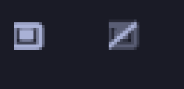

# Auto Picture-in-Picture for Omarchy

Watching a video and need to jump to another desktop? With this, the video
follows you. Leave a desktop where a video is playing and it pops out into a
small window pinned in a corner of every desktop. Go back to that desktop and
it pops back in as if nothing happened.

It works with two kinds of source:

- **Browsers** (Chromium, Brave, Chrome, Vivaldi, Edge): YouTube, Twitch or any
  other site. The video moves into the browser's own picture-in-picture
  window and carries on in its tab when it closes.
- **Video players** (mpv, VLC, Celluloid, or any you add): the player's own
  window shrinks into the corner, then returns to its size, place and
  fullscreen. Anything that plays in mpv counts, such as an Ace Stream or IPTV
  player.

For [Omarchy](https://omarchy.org) and other [Hyprland](https://hyprland.org)
setups. Tested with Chromium and mpv; the others share their machinery but are
untested so far.



## How it behaves

- **Only when something is playing.** A paused video stays where it is.
  (Players that don't report whether they're playing count as playing while
  their window is open; for mpv, install `mpv-mpris`, which Omarchy has.)
- **One at a time.** If several things play on the desktop you leave, the
  window you used last wins.
- **It remembers where you put it.** Drag or resize the PiP once and it opens
  there from then on.
- **It never moves you.** Opening a browser's PiP needs a keypress in the
  browser, so for a moment the keyboard goes to the browser and straight back
  to the window you were using. If you type at that exact instant, a key could
  land in the browser.
- **On/off switch:** the bar icon (dimmed and crossed out when off), or
  `auto-pip toggle` on a key. Switching off also closes an open PiP.
- A PiP you open yourself is left alone.

## Requirements

- Hyprland **0.56 or newer** (Lua dispatchers).
- `jq`, `socat`, `busctl` (systemd) and `flock`. All come with Omarchy.
- A Chromium-based browser and/or a video player.
- Omarchy for the bar icon. Without it, everything else works; see
  [Without Omarchy](#without-omarchy).

## Install

```bash
omarchy plugin add https://github.com/okox/omarchy-auto-pip.git
~/.config/omarchy/plugins/okox.auto-pip/setup.sh
```

Or clone it anywhere and run `./setup.sh`. Re-run it any time to update.

Setup:

1. Puts the project in `~/.config/omarchy/plugins/okox.auto-pip` and an
   `auto-pip` command in `~/.local/bin`.
2. Adds the browser extension to `~/.config/chromium-flags.conf` (and
   `brave-flags.conf` if you use Brave).
3. Starts the watcher as a systemd user service, `auto-pip.service`, which
   runs with your desktop session.
4. Puts the icon on the right of the bar.

Then **restart your browser once** so it loads the extension.

**Google Chrome, Vivaldi, Edge:** Chrome ignores the extension flag, so load
it by hand: open `chrome://extensions`, switch on *Developer mode*, click
*Load unpacked* and pick `~/.config/omarchy/plugins/okox.auto-pip/extension`.

### A key to switch it

Add to `~/.config/hypr/bindings.lua`:

```lua
o.bind("SUPER + ALT + P", "Auto picture-in-picture on/off", "auto-pip toggle")
```

## Settings

`~/.config/auto-pip/config`, plain shell variables
([all of them](examples/config)). After a change:
`systemctl --user restart auto-pip`.

```bash
TITLE='YouTube|Twitch'   # browsers: only these sites (window title); default: any
PLAYERS='mpv|vlc|haruna' # player window classes; default: mpv|vlc|celluloid; '' = none
SIZE='480 270'           # first PiP size; afterwards it remembers yours
NOTIFY=0                 # no notification when switching on/off
```

A player's window class is in `hyprctl clients` (the `class:` line).

To switch something else along with it,
put an executable `~/.config/auto-pip/on-switch`; it gets `on` or `off`
([example](examples/on-switch)).

## Commands

```
auto-pip on | off | toggle   switch it (switching off closes an open PiP)
auto-pip status              prints on or off
auto-pip close               close the PiP it opened, now
auto-pip watch               the watcher itself (run by auto-pip.service)
```

## How it works

A **watcher** (`bin/auto-pip`) listens to Hyprland's desktop changes. When
you leave a desktop, it looks there for a browser or player window, most
recently used first, and asks its media player on D-Bus (MPRIS) whether it's
playing.

- **Players:** it floats, shrinks, pins and moves the player's window with
  Hyprland dispatchers, after noting its size, place and fullscreen. Coming
  back reverses all of it.
- **Browsers:** a page may only open picture-in-picture in response to
  something you do, such as a click or a keypress. So there's a second half:

  **a tiny browser extension** with two keyboard shortcuts, Alt+Shift+8 (open
  PiP for the biggest playing video in the tab) and Alt+Shift+9 (close it).
  It has no background activity, reads nothing and sends nothing anywhere;
  it only acts when one of its shortcuts is pressed. The watcher sends the
  browser window that shortcut with Hyprland's `send_shortcut`, pins the PiP
  in its spot, and sends the closing one when you come back.

If a shortcut clashes with something, change it at
`chrome://extensions/shortcuts` and set `MODS`, `OPEN_KEY` and `CLOSE_KEY`
in the config to match.

## Without Omarchy

Everything except the bar icon works on any Hyprland 0.56+. Run `./setup.sh`
from a clone (it skips the bar), and give PiP windows a floating, pinned rule,
which Omarchy has built in:

```lua
hl.window_rule({ match = { title = "^Picture.?in.?[Pp]icture$" }, float = true, pin = true })
```

For Waybar, a custom module can show `auto-pip status` and run
`auto-pip toggle` on click.

## Troubleshooting

- **Nothing happens:** check the browser has loaded the extension
  (`chrome://extensions`) and that its shortcuts are set
  (`chrome://extensions/shortcuts`). Then `journalctl --user -u auto-pip`.
- **Pops out from the wrong window:** set `TITLE` so only video sites count,
  or `PLAYERS` to just the players you want.
- **A player didn't pop out:** check its class (`hyprctl clients`) is in
  `PLAYERS`, and that it's playing (`busctl --user list | grep mpris`).
- **Flatpak or Snap browsers** aren't supported yet.

## Uninstall

```bash
~/.config/omarchy/plugins/okox.auto-pip/uninstall.sh          # keeps your settings
~/.config/omarchy/plugins/okox.auto-pip/uninstall.sh --purge  # removes them too
```

## License

[MIT](LICENSE)
